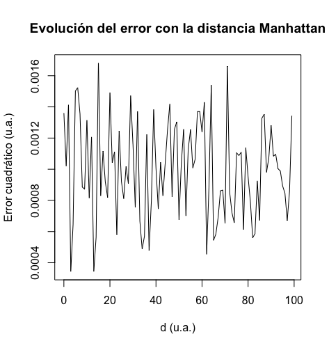

```{r setup, include=FALSE}
library(knitr)

opts_chunk$set(
  echo = FALSE, warning = FALSE, message = FALSE, comment = "", 
  cache = TRUE, tidy = FALSE, prompt = FALSE
)

```

```{r}
# ---- PAQUETS I LLIBRERIES ----

#' Instal·lació de paquets
#' 
#' @description
#' Comrpova si els paquets d'una llista estan instal·lats al sistema. 
#' Si algun no ho està, l'instal·la automàticament.
#'
#' @param pkg Vector de caràcters amb els noms dels paquets.
#'
#' @returns No retorna cap valor.
#' 
#' @importFrom utils install.packages
#' @export
#'
#' @examples
#' \dontrun{
#' # Exemple d'ús amb dades hipotètiques
#' install_if_not(packages)
#' }
install_if_not <- function(pkg) {
  for (p in pkg) {
    if (!requireNamespace(p, quietly = TRUE)) {
      install.packages(p, dependencies = TRUE)
    }
  }
}

# Llista de paquets i instal·lació
paquets <- c("tidyverse", "readxl", "gtsummary", "GGally", "naniar")

install_if_not(paquets)

rm(paquets)

```

```{r}
# Gestió de dades
library(tidyverse)
library(readxl)

# Estadística descriptiva
library(gtsummary)
library(GGally)

# Gestió de valors faltants
library(naniar)


```

# Introducció

## Context i justificació del treball

La rehabilitació cardíaca (RC) és una intervenció amb eficàcia demostrada per a la recuperació posterior a esdeveniments cardiovasculars. Les persones que participen en programes de RC presenten millors resultats clínics, a més d’una reducció en la taxa de readmissions hospitalàries i en la mortalitat i d’un efecte positiu en la qualitat de vida [@tessler2026]. No obstant això, la participació en aquesta mena d'intervencions és considerablement baixa i existeixen diferències de gènere en tres àrees clau: l'accés als programes, l'adherència al tractament i els resultats clínics obtinguts. Les barreres que originen aquestes desigualtats poden ser individuals, socials o pròpies dels sistemes sanitaris [@coutinho2025].

La infrarepresentació de les dones, així com d’altres col·lectius vulnerables, pot conduir a biaixos en la recerca i, en última instància, a una disminució de l’eficàcia dels tractaments. Els mètodes d'aprenentatge automàtic (ML, per les seves sigles en anglès) poden ser útils per mitigar aquestes desigualtats, però també poden perpetuar-les si no se'n tenen en compte els potencials biaixos [@caton2024]. Per això és necessari disposar d'eines per avaluar l'equitat algorítmica (*fairness*) dels models emprats i, posteriorment, millorar-la sense comprometre la precisió de les prediccions.

La tria de l'àmbit del treball està motivada per la meva formació i experiència professional prèvia com a fisioterapeuta, amb especial interès en la rehabilitació cardiorespiratòria. Si bé els biaixos en el diagnòstic i el tractament de patologies cardiovasculars són de domini públic des de fa temps, no s'ha d'oblidar l'impacte que tenen al llarg de tot el procés d'atenció sanitària, en què intervenen altres disciplines a banda de la medicina. És important dur a terme recerca de qualitat en infermeria, fisioteràpia, psicologia o nutrició per assegurar uns resultats òptims i lliures de discriminacions.

En definitiva, aquest treball pretén estudiar l’impacte dels biaixos de sexe i gènere en la predicció de resultats clínics de la RC, avaluar-ne l'equitat algorítmica i proposar mesures per atenuar-ne els efectes.

## Descripció general

Per a la realització d'aquest treball, s'ha optat per utilitzar l'estudi *Functional capacity and patient-reported outcome measures after cardiac rehabilitation: a prospective study with 6-month follow-up* [@vieli2025] com a font de dades. S'hi pot accedir a través dels enllaços que s'inclouen a continuació:

- **Estudi**: <https://smw.ch/index.php/smw/article/view/4160/6376>.

- **Dades**: <https://data.mendeley.com/datasets/hbztb7wmc5/1>.

El conjunt de dades conté 273 registres, majoritàriament homes (81%). Si bé aquest fet pot esdevenir una limitació per a l'auditoria de gènere, també evidencia el biaix de representació existent a la literatura científica. Les variables sobre les quals es treballarà es poden agrupar en tres àmbits:

- **Demogràfiques**: edat, sexe, diagnòstic, antecedents de tabaquisme.

- **Capacitat funcional**: prova de la marxa de 6 minuts (6MWT), capacitat d'exercici màxima a curt termini (MSEC), equivalent metabòlic de l'activitat (MET), força isomètrica màxima del quàdriceps (QIS).

- **Qüestionaris de salut**: escales d'ansietat i depressió (HADS), qualitat de vida (HeartQoL) i nivells de treball, esport i activitat física (Baecke).

## Objectius del treball

A continuació es detalla la relació d'objectius principals i secundaris del treball:

\begin{enumerate}[label=\arabic*.]
\item Determinar l'impacte dels biaixos de sexe i gènere en la predicció de la resposta a la rehabilitació cardíaca.

  \begin{enumerate}[label*=\arabic*.]
  \item Descriure l'estat actual de l'evidència científica en l'àmbit d'estudi.
  \item Elaborar diferents models predictius per explicar els resultats de les variables d'interès.
  \item Quantificar les diferències en les prediccions dels models proposats mitjançant mètriques d'equitat algorítmica.
  \end{enumerate}
  
\item Proposar mesures per atenuar els biaixos detectats.

  \begin{enumerate}[label*=\arabic*.]
  \item Exposar tècniques de preprocessament, processament i postprocessament utilitzades per corregir la disparitat de les dades.
  \item Avaluar l'adequació de les mesures als models predictius proposats.
  \end{enumerate}

\end{enumerate}

## Enfocament i mètode seguit

### Estratègia de recerca

En una primera fase del treball, es durà a terme una cerca de literatura científica a les principals bases de dades d'investigació clínica (PubMed, Cochrane Library, ScienceDirect...), així com en altres fonts especialitzades que es considerin rellevants.

Els resultats obtinguts es filtraran segons la seva adequació al tema i es classificaran en tres àmbits que permetran estructurar-ne adequadament els continguts:

- **Rehabilitació cardíaca**: estat de l'art general, càrrega de les patologies cardiovasculars en la salut global, impacte en resultats clínics, descripció de variables predictores.

- **Biaixos de sexe i gènere**: diferències en l'accés, la participació i els resultats de la rehabilitació cardíaca, interseccionalitat de les desigualtats, intervencions proposades.

- **Equitat algorítmica**: evidència sobre mètodes estadístics, limitacions i propostes de mitigació de biaixos.

### Metodologia de treball

Un cop feta la recerca d'evidència, es procedirà a l'anàlisi de les dades disponibles mitjançant el programari `R` i adoptant, en la mesura del possible, els principis del `tidyverse`. Se seguiran els passos que s'indiquen:

- **Preprocessament de dades**: neteja, tractament de valors nuls, anàlisi descriptiva estratificada per sexe i definició de variables objectiu. Les principals variables d'interès són la capacitat funcional (mesurada habitualment amb la 6MWT) i la qualitat de vida, que es poden binaritzar en funció de si la millora és superior o no a la mínima diferència clínicament important per a cada cas.

- **Modelització estadística**: construcció de models predictius a partir del conjunt de dades. Tenint en compte les característiques de les variables objectiu, es prendrà com a model de referència la regressió logística. S'optimitzarà el model amb mètodes de regularització (Ridge, LASSO). Malgrat que el nombre de registres és limitat, es podria comparar el resultat amb una alternativa no lineal, com ara un Random Forest.

- **Avaluació i auditoria de gènere**: valoració del rendiment del model. A més de les mesures habituals, s'utilitzaran les mètriques d'equitat algorítmica que es considerin adequades d'entre les descrites a la literatura científica.

- **Discussió de resultats**: exploració de tècniques de mitigació de biaixos i elaboració de recomanacions metodològiques per a futures investigacions.

Aquest enfocament permetrà, d'una banda, disposar del context clínic adient per a la comprensió dels resultats i, de l'altra, garantir un tractament net i reproduïble de les dades.

## Impacte en sostenibilitat, ètic-social i de diversitat

L'impacte d'aquest treball es concreta principalment en els objectius de desenvolupament sostenible (ODS) que es detallen:

- **ODS 3: Salut i benestar**.

  3.4. Per a 2030, reduir en un terç la mortalitat prematura per malalties no transmissibles mitjançant la prevenció i el tractament i promoure la salut mental i el benestar.

- **ODS 5: Igualtat de gènere**.

  5.1. Posar fi a totes les formes de discriminació contra totes les dones i les nenes a tot el món.

- **ODS 16: Pau, justícia i institucions sòlides**.

  16.6. Crear en tots els nivells institucions eficaces i transparents que retin comptes.

  16.7. Garantir l'adopció en tots els nivells de decisions inclusives, participatives i representatives que responguin a les necessitats.

D'altra banda, el treball inclou la perspectiva de gènere en el seu mateix disseny. En aquest sentit, es pretén identificar i combatre els biaixos existents en la recerca clínica per fomentar una investigació més inclusiva i accessible per a tothom. És responsabilitat del personal sanitari i de recerca contemplar la dimensió ètica i social de la seva tasca, de manera que puguin vetllar per la reducció de les desigualtats basades en prejudicis de gènere, ètnia, edat, estatus socioeconòmic, capacitats o orientació sexual, entre d'altres. A més, cal destacar que l'optimització de sistemes de suport a la decisió clínica basats en models predictius té la capacitat de millorar els circuits existents d'atenció sanitària. D'aquesta manera, es podrà contribuir a un ús més eficient dels recursos i, en conseqüència, s'aconseguirà un impacte positiu en termes de sostenibilitat a mitjà i llarg termini.

Per acabar, es farà ús de les formes inclusives del llenguatge que s'escaiguin en cada context. De manera puntual i honorífica, es pot emprar el femení com a genèric per referir-se a les persones professionals de la salut, de qualsevol gènere, donat l'elevat percentatge de dones que exerceixen aquestes professions.

\pagebreak

## Planificació del treball

### Tasques

A la **\autoref{tab:taula1-1}** es descriuen les tasques que caldrà desenvolupar durant el treball, que s'han detallat a l'apartat **[Enfocament i mètode seguit]**. S'indica també la relació amb els objectius proposats.

| Tasca                             | Objectius     | Inici    | Final    | Estat      |
|-----------------------------|------------|----------|----------|-------------|
| **1. Definició i pla de treball** |               |          |          |            |
| Plantejament del treball          |               | 23/9/26  | 7/10/26  | Completada |
|                                   |               |          |          |            |
| **2. Estat de l'art**             |               |          |          |            |
| Cerca preliminar d'evidència      | 1.1, 2.1      | 23/9/26  | 7/10/26  | Completada |
| Revisió de l'evidència trobada    | 1.1, 2.1      | 1/10/26  | 28/10/26 | Completada |
|                                   |               |          |          |            |
| **3. Implementació**              |               |          |          |            |
| Preprocessament de dades          | 1.2           | 29/10/26 | 11/11/26 | En curs    |
| Modelització estadística          | 1.2           | 12/11/26 | 25/11/26 | Pendent    |
| Avaluació i auditoria de gènere   | 1.2, 1.3, 2.2 | 12/11/26 | 25/11/26 | Pendent    |
| Discussió de resultats            | 1.3, 2.2      | 26/11/26 | 2/12/26  | Pendent    |
|                                   |               |          |          |            |
| **4. Lliurament final**           |               |          |          |            |
| Introducció                       |               | 23/9/26  | 14/10/26 | Completada |
| Estat de l'art                    | 1.1, 2.1      | 15/10/26 | 4/11/26  | Completada |
| Materials i mètodes               | 1.2           | 5/11/26  | 25/11/26 | Pendent    |
| Resultats                         | 1.3, 2.2      | 26/11/26 | 16/12/26 | Pendent    |
| Discussió                         | 1.1, 1.3, 2.2 | 17/12/26 | 31/12/26 | Pendent    |
| Conclusions                       |               | 1/1/27   | 7/1/27   | Pendent    |
| Glossari i Annexos                |               | 23/9/26  | 7/1/27   | En curs    |
| Article                           |               | 15/10/26 | 7/1/27   | En curs    |
|                                   |               |          |          |            |
| **5. Presentació**                |               |          |          |            |
| Elaboració de diapositives        |               | 8/1/27   | 13/1/27  | Pendent    |
| Enregistrament                    |               | 8/1/27   | 13/1/27  | Pendent    |

: Planificació de tasques {#tab:taula1-1}

\pagebreak

### Calendari

La \autoref{fig:gantt} mostra el diagrama de Gantt corresponent a les tasques descrites.

```{r gantt, fig.cap="Calendari de tasques", fig.pos="H", fig.height=6, out.width="100%"}
# ---- 1.6 PLANIFICACIÓ DEL TREBALL ----

# 1. Data frame de tasques
df_gantt <- data.frame(
  Fase = factor(rep(c(
    "1. Definició i pla de treball",
    "2. Estat de l'art",
    "3. Implementació",
    "4. Lliurament final",
    "5. Presentació"
  ), times = c(1, 2, 4, 8, 2))),
  Tasca = c(
    "Plantejament del treball", 
    "Cerca preliminar d'evidència", 
    "Revisió de l'evidència trobada", 
    "Preprocessament de dades", 
    "Modelització estadística", 
    "Avaluació i auditoria de gènere", 
    "Discussió de resultats", 
    "Introducció", 
    "Estat de l'art", 
    "Materials i mètodes", 
    "Resultats", 
    "Discussió", 
    "Conclusions", 
    "Glossari i Annexos", 
    "Article", 
    "Elaboració de diapositives", 
    "Enregistrament"
  ),
  Objectius = c(
    "", "1.1, 2.1", "1.1, 2.1", "1.2",
    "1.2", "1.2, 1.3, 2.2", "1.3, 2.2", "",
    "1.1, 2.1", "1.2", "1.3, 2.2", "1.1, 1.3, 2.2",
    "", "", "", "", ""
  ),
  Inici = as.Date(c(
    "2026-09-23", "2026-09-23", "2026-10-01", "2026-10-29",
    "2026-11-12", "2026-11-12", "2026-11-26", "2026-09-23",
    "2026-10-15", "2026-11-05", "2026-11-26", "2026-12-17",
    "2027-01-01", "2026-09-23", "2026-10-15", "2027-01-08", 
    "2027-01-08"
  )),
  Final = as.Date(c(
    "2026-10-07", "2026-10-07", "2026-10-28", "2026-11-11",
    "2026-11-25", "2026-11-25", "2026-12-02", "2026-10-14",
    "2026-11-04", "2026-11-25", "2026-12-16", "2026-12-31",
    "2027-01-07", "2027-01-07", "2027-01-07", "2027-01-13", 
    "2027-01-13"
  )),
  Estat = factor(c(
    "Completada", "Completada", "Completada", "En curs",
    "Pendent", "Pendent", "Pendent", "Completada",
    "Completada", "Pendent", "Pendent", "Pendent",
    "Pendent", "En curs", "En curs", "Pendent", "Pendent"
  ), levels = c("Completada", "En curs", "Pendent"))
)

# 2. Tasques ordenades
df_gantt <- df_gantt |> 
  mutate(Tasca = fct_inorder(Tasca) |> fct_rev())

# 3. Dates
inici <- as.Date("2026-09-23")
final <- as.Date("2027-01-13")

dates <- seq(inici, final, by = "1 week")

# 4. Diagrama de Gantt
plot_gantt <- ggplot(df_gantt, 
                     aes(x = Inici, xend = Final,
                         y = Tasca, yend = Tasca,
                         color = Estat)) +
  geom_segment(linewidth = 3) +
  
  # 4.1. Eix x (data)
  scale_x_date(date_labels = "%d/%m",
               breaks = dates,
               limits = c(inici, final),
               expand = expansion(mult = c(0.01, 0.02))) +
  
  # 4.2. Color segons estat
  scale_color_manual(values = c("Completada" = "#03047a",
                                "En curs" = "#7ff0ff",
                                "Pendent" = "#d0d0d0")) +
  
  # 4.3. Separació per fases
  facet_wrap(~ Fase, ncol = 1, scales = "free_y", 
             space = "free_y") +
  
  # 4.4. Estètica
  theme_minimal() +
  labs(x = "", y = "", color = NULL) +
  theme(
    legend.position = "bottom",
    axis.text.x = element_text(angle = 45, hjust = 1, 
                               vjust = 1),
    strip.text = element_text(face = "bold", hjust = 0)
  )

plot_gantt

rm(inici, final, dates)

```

\pagebreak

### Fites

A la **\autoref{tab:taula1-2}** s'indiquen les fites corresponents a cada prova d'avaluació continuada (PAC).

| Fita                              | Termini  | Estat      |
|-----------------------------------|----------|------------|
| **Entrega**: PAC 1                | 7/10/26  | Completada |
| Final de la recerca bibliogràfica | 28/10/26 | Completada |
| **Entrega**: PAC 2                | 4/11/26  | Completada |
| Final de la implementació         | 25/11/26 | En curs    |
| **Entrega**: PAC 3                | 2/12/26  | Pendent    |
| Cos del treball redactat          | 31/12/26 | En curs    |
| **Entrega**: PAC 4 i article      | 7/1/27   | Pendent    |
| **Entrega**: PAC 5                | 13/1/27  | Pendent    |

: Fites {#tab:taula1-2}

### Anàlisi de riscos

La **\autoref{tab:taula1-3}** descriu els riscos que poden fer que la planificació no es compleixi i les accions previstes per al pla de contingència.

| Risc | Impacte | Probabilitat | Mitigació |
|----------------------|----------|-------------|----------------------------|
| Abundància de registres incomplets en les dades | Alt | Alta | Imputació de valors faltants o eliminació dels registres afectats o de variables que no es considerin crítiques, segons el cas |
| Biaixos inherents a la composició del conjunt de dades | Alt | Alta | Comparació dels resultats amb l'evidència disponible i aplicació de tècniques de ponderació o remostreig |
| Desviacions del pla de treball marcat | Mitjà | Mitjana | Establiment de fites parcials per a les PAC, de manera que l'última setmana de cadascuna es pugui reservar per a la revisió o com a marge per acabar de completar les tasques pendents |
| Problemes de reproductibilitat | Mitjà | Baixa | Documentació rigorosa del codi i creació d'un repositori de GitHub que contingui tots els documents rellevants |

: Anàlisi de riscos {#tab:taula1-3}

## Resultats esperats

<!-- ## Breu sumari de productes obtinguts -->

Al final del projecte s'obtindran els productes següents:

- Una **memòria** del treball, que contindrà la planificació, l'estat de l'art i els resultats obtinguts en el seu desenvolupament.

- **Informes** de progrés per a cadascuna de les entregues de l'avaluació continuada.

- Una síntesi de les troballes més rellevants en format d'**article** científic.

- Una **presentació** en format virtual i les corresponents diapositives de suport.

<!-- ## Breu descripció dels altres capítols de la memòria -->

<!-- Breu explicació dels continguts de cada capítol i la seva relació amb el projecte global. -->

## Ús responsable de la intel·ligència artificial

L'ús de la intel·ligència artificial (IA) generativa en aquest treball estarà limitat segons el que estableixen els criteris d'integritat acadèmica de la UOC. Se'n preveu l'ús en algunes tasques menors, com ara per complementar la recerca d'evidència científica, depurar codi o gestionar errors en l'exportació del document PDF final, sempre sota supervisió de l'autor.

Es declara que en cap cas s'empraran eines d'IA per a la redacció de contingut o la interpretació de resultats, ni per a cap altra tasca que pugui entrar en conflicte amb les limitacions d'un ús ètic, crític i responsable.

# Estat de l'art

## Rehabilitació cardíaca

### Antecedents

Les cardiopaties isquèmiques han estat la primera causa de mortalitat estandarditzada per edat a tot el món des de l'any 1990 (amb l'única excepció del 2021, en què la primera posició va ser ocupada per la COVID-19) [@collaborators2025]. A més, l'any 2023 van esdevenir la primera causa de mortalitat prematura i salut precària a escala mundial [@collaboratorsgbd2023diseaseandinjuryandriskfactor2025]. Malgrat els avenços en el diagnòstic i el tractament d'aquesta mena de patologies, és necessari garantir que aquestes millores arriben a totes les poblacions de manera equitativa i lliure de discriminacions.

La rehabilitació cardíaca (RC) és l'etiqueta sota la qual s'engloben un conjunt de programes de característiques similars que les guies de pràctica clínica recomanen per a la recuperació d'esdeveniments cardiovasculars (p. ex. insuficiència cardíaca, infart agut de miocardi [IAM], malalties cardíaques congènites o diferents intervencions quirúrgiques amb afectació de l'aparell cardiorespiratori). Els seus objectius principals són reduir l'estrès fisiològic i psicològic produït per aquestes patologies, reduir la mortalitat, prevenir hospitalitzacions recurrents i millorar la funció cardiovascular i la qualitat de vida (QdV) de les persones ateses [@tessler2026].

Els programes de RC tradicionals es fonamenten en l'exercici terapèutic, però la pràctica basada en evidència hi ha anat incorporant altres components, convertint-la en una intervenció interdisciplinària que demana la col·laboració de professionals de disciplines tan diverses com la infermeria, la fisioteràpia, la medicina, la nutrició o la psicologia [@taylor2022]. El seu contingut varia en funció de l'evolució de l'episodi: sol incloure teràpia de mobilització precoç i educació sanitària en la fase hospitalària, exercici supervisat, prevenció de factors de risc i suport psicosocial en fase ambulatòria i activitat física regular i intervencions d'autocontrol de la patologia en fase domiciliària [@tessler2026].

Es tracta d'una intervenció segura, amb un risc baix de complicacions i amb nombrosos beneficis demostrats. En persones que conviuen amb malalties coronàries, la RC redueix el risc de patir un IAM (risc relatiu [RR] 0,72 [0,55–0,93], qualitat d'evidència alta) i el nombre d'hospitalitzacions (RR 0,58 [0,43–0,77], qualitat d'evidència moderada), a la vegada que permet aconseguir millores en la mortalitat per causes cardiovasculars, la QdV i la cost-efectivitat dels tractaments [@dibben2023]. Resultats semblants s'obtenen en casos d'insuficiència cardíaca. En una patologia que suposa una elevada càrrega per a les persones que la pateixen, una disminució de la tolerància a l'exercici, un major risc de mortalitat i readmissions hospitalàries i, en conseqüència, un cost més elevat per als sistemes sanitaris, la RC permet reduir el nombre d'ingressos (RR 0,69 [0,56–0,86], qualitat d'evidència moderada) i millorar la QdV relacionada amb la salut [@molloy2024].

En altres condicions de salut, com les cirurgies valvulars o la fibril·lació auricular, encara manca evidència de qualitat per avaluar l'impacte real de la RC basada en exercici [@abraham2021; @buckley2024]. Tanmateix, la RC podria reduir el risc de recurrència de la fibril·lació auricular (RR 0,70 [0,56–0,88], qualitat d'evidència moderada) i millorar-ne la QdV [@buckley2024]. Un altre aspecte que cal considerar és l'afectació que tenen les malalties cardiovasculars en salut mental, que precisament està considerada com un dels factors de risc que les pot desencadenar [@wrzeciono2024]. En persones que havien patit un IAM, la RC va tenir efectes positius en els nivells d'ansietat i depressió. A més, l'inici precoç del tractament va suposar un augment de la QdV i una reducció de la mortalitat i la morbiditat [@zheng2019].

Per entendre millor els efectes de la RC sobre diferents patologies cardiovasculars, cal analitzar-ne els principals resultats clínics i les variables que s'acostumen a emprar per a la seva predicció.

### Resultats clínics i variables predictores

En general, els resultats clínics de la RC es poden agrupar en dos àmbits: la capacitat funcional i la qualitat de vida. En la primera sol ser rellevant conèixer la capacitat aeròbica, mitjançant una ergometria o una prova funcional com la 6MWT, i la força màxima dels principals grups musculars que intervenen a la marxa. Pel que fa a la segona, és habitual l'ús de mesures de resultat informades pel pacient (PROMs, per les seves sigles en anglès), que inclouen els nivells d'ansietat, depressió, activitat física o QdV relacionada amb la salut. És important disposar d'aquestes mesures perquè estan associades amb la taxa de mortalitat, la recurrència d'hospitalitzacions, la rendibilitat dels tractaments i l'impacte en les activitats de la vida diària (AVD) [@vieli2025].

En general, la RC és una intervenció eficaç per incrementar la tolerància a l'exercici i el benestar de les persones que hi participen [@taylor2022]. No obstant això, els resultats poden diferir en funció de les característiques pròpies de cada pacient. Alguns factors que influeixen en la millora final són l'edat, l'estat físic inicial, l'índex de massa corporal (IMC), la presència de comorbiditats o paràmetres hemodinàmics, com l'hemoglobina, la pressió arterial o la fracció d'ejecció ventricular esquerra (FEVE) [@suzuki2018; @baldasseroni2022; @tokeshi2023; @uszko-lencer2017; @kurpaska2025].

S'ha omès deliberadament d'aquesta llista el sexe, sobre el qual es tractarà amb més profunditat en els apartats següents. Tot i que alguns estudis apunten que les persones de sexe masculí (v. **[Consideracions sobre el sexe i el gènere]**) podrien aconseguir millors resultats en la 6MWT [@bargehr2017; @sutherland2018], d'altres obtenen resultats contraris [@artiles2023]. Per acabar, cal destacar la relació de reciprocitat que existeix entre la capacitat funcional i la QdV: mentre que l'ansietat i la depressió tenen un impacte negatiu en l'activitat física [@sakamoto2022], un augment d'aquesta darrera pot contribuir a obtenir nivells més elevats de benestar [@kjesbu2024].

### Reptes

A mesura que l'evidència científica sobre RC creix en nombre i en qualitat, també es van detectant reptes importants que cal abordar per tal d'optimitzar-ne els resultats clínics. D'una banda, la participació als programes és relativament baixa: només s'hi inscriuen prop d'un 25% de pacients elegibles [@tessler2026]. Aquest fet pot ser degut a l'existència de barreres tant clíniques com personals o dels sistemes sanitaris. Determinats col·lectius, com les dones, les persones d'edat avançada, racialitzades o de minories ètniques o socials, tenen menor probabilitat de participació. L'envelliment poblacional, a més, comporta un increment de les comorbiditats (p. ex. hipertensió arterial [HTA], diabetis, fibril·lació auricular), que també suposen un obstacle important per a la inclusió en programes de RC [@taylor2022].

L'adherència terapèutica és un component imprescindible de qualsevol tractament i, en el cas de la RC, les taxes d'abandonament són considerablement elevades. La persistència en l'exercici terapèutic pot caure fins a prop del 50% al cap de 6 mesos o fins al 10% al cap d'un any [@young2020]. Aquest fet és preocupant, perquè el compliment terapèutic és un dels principals predictors de la millora de resultats clínics i del seu manteniment a mitjà i llarg termini. Es tracta d'un problema complex en què influeixen factors demogràfics, clínics i psicosocials [@malak2021; @yuan2026].

És necessari, per tant, millorar l'accés i la participació als programes de RC. Amb aquesta finalitat, han pres força alternatives de rehabilitació domiciliària i, fins i tot, virtual, així com programes adaptats a diferents col·lectius. No obstant això, als estudis disponibles encara s'hi troben infrarepresentades les dones, les persones d'edat avançada o de països de renda baixa i mitjana [@molloy2024]. Si bé s'està avançant en la generalitzabilitat de l'evidència, encara queda un llarg camí per recórrer, com s'argumentarà en els propers apartats.

## Consideracions sobre el sexe i el gènere

La inclusió del sexe i el gènere en recerca és complexa i, a falta d'un estàndard clar, sovint existeix confusió entre els dos termes [@regensteiner2019]. El sexe és una característica biològica, determinada pel cariotip, els gàmetes, els òrgans reproductius o la funció hormonal. El gènere, en canvi, es refereix als components socials que s'atribueixen a un sexe determinat: els rols, comportaments i expectatives associats a una població, lloc i temps històric, però també la identitat percebuda, la performativitat o l'estigma cap a certes expressions considerades fora de la normativitat [@bewley2021; @bauer2022].

La importància del sexe i el gènere rau en la seva multidimensionalitat i en l'associació amb altres variables que poden ser d'interès segons el context, com ara l'expressió gènica o el pes corporal. Més encara, el sexe i el gènere poden actuar com a mesures indirectes (*proxy*), de manera que cal entendre les relacions causals subjacents que s'estableixen entre variables [@bauer2022].

Existeixen diferents problemes pel que fa a l'ús del sexe i el gènere en recerca clínica. Majoritàriament, els estudis inclouen només el sexe; és el cas del que s'utilitza en aquest treball com a font de dades. S'ha considerat que, tot i aquesta limitació, les dades disponibles seran suficients per il·lustrar les desigualtats entre sexes sense dilatar l'abast del treball més enllà d'uns límits raonables. Tanmateix, cal tenir en compte que el gènere també pot ser un factor de risc per a nombroses malalties i pot influir en l'adherència i l'eficàcia dels tractaments [@bewley2021].

De fet, els factors socials poden tenir efectes sobre els processos biològics: per exemple, en rehabilitació, els hàbits d'exercici afecten notablement la capacitat funcional. Ara bé, com examinen Hélène Colineaux et al. [@colineaux2022], la mesura del gènere és complexa: encara que habitualment es binaritza per la influència de la concepció normativa del sexe, es tracta d'un fenomen continu que depèn del context i que pot fluctuar en el temps. També la mesura dels efectes del sexe i el gènere és difícil; en aquest sentit, les autores proposen un marc per entendre els diferents mecanismes causals que hi intervenen:

\bigskip

**Efecte total del sexe**. És la diferència en la variable resposta entre haver nascut mascle o femella sense tenir en compte altres mecanismes. És la mesura que es fa servir més habitualment i que s'utilitzarà també en aquest treball.

**Efecte indirecte del sexe mediat socialment**. Es tracta de l'efecte del sexe que està mediat per mecanismes socials de gènere (i. e. la diferència en la resposta entre gèneres si el sexe es manté constant).

**Efecte directe o residual del sexe**. És l'efecte del sexe biològic que no es veu afectat per components de gènere (i. e. la diferència en la resposta entre sexes si el gènere es manté constant).

**Efecte del gènere controlat per sexe**. Correspon a l'efecte total del gènere sense tenir en compte el sexe de naixement, que en aquest cas és un factor de confusió.

\bigskip

La manca d'anàlisi de les diferències de sexe i gènere o la infrarepresentació de les dones en recerca tenen efectes negatius en la qualitat dels resultats obtinguts i, per extensió, en la salut de totes les persones (no només les dones) [@colantonio2023]. Malgrat que existeixen guies per incloure el sexe i el gènere en recerca, els plans inicials no sempre es reflecteixen en la transferència del coneixement. A més, és important considerar la interseccionalitat amb altres desigualtats, com les que sorgeixen de l'edat, l'ètnia o la classe socioeconòmica, entre d'altres. En aquest treball s'intentarà donar resposta a alguns d'aquests aspectes.

## Biaixos existents

Les malalties cardiovasculars són la primera causa de mortalitat a escala global: això és cert també per a les dones [@alexander2022]. La RC compta amb la recomanació de classe 1A de l'American Heart Association i l'American College of Cardiology [@khadanga2021] pels beneficis que aporta en la millora de factors de risc, la reducció d'hospitalitzacions i mortalitat i l'augment de QdV. Específicament en el cas de les dones, la RC pot contribuir a una major reducció del risc de mortalitat, millores superiors en capacitat d'exercici i salut mental i una disminució dels nivells d'HTA [@coutinho2025].

No obstant això, les dones pateixen restriccions en l'accés i la participació als programes de rehabilitació i, en conseqüència, els seus resultats clínics es veuen alterats. A continuació es detallen les principals barreres existents i les intervencions que s'han proposat per superar-les.

### Derivació i reclutament

La participació global als programes de RC ja és baixa, però encara ho és més entre les dones. La primera barrera d'accés es troba en el moment de la derivació per part del personal mèdic: malgrat que els beneficis d'aquesta mena d'intervencions no difereixen entre sexes, les dones tenen prop d'un 32% menys de probabilitat de ser derivades a rehabilitació en comparació a homes amb criteris d'elegibilitat similars [@alexander2022]. Aquest fet s'explica per diferents motius, que es poden agrupar en tres àmbits clau:

\bigskip

**Factors individuals**. Es refereixen a aspectes com la falta de coneixement sobre la RC, el nivell educatiu o barreres culturals i lingüístiques que dificulten l'accés a determinats col·lectius. Per exemple, encara que les dones afroamericanes tenen una major incidència de malalties cardiovasculars, les taxes de derivació en aquest grup poblacional són menors [@sawan2022].

**Factors socials**. És l'àrea en què més influència tenen els rols i les expectatives de gènere. Les dones solen càrregar un pes molt superior en les tasques de cures, especialment en l'àmbit domèstic i familiar. Aquest fet, juntament amb la manca de suport psicosocial, està associat a nivells més elevats d'estrès, ansietat i depressió [@alexander2022]. També poden comprometre l'accés a la RC els desavantatges socioeconòmics, els conflictes laborals o les dificultats en el transport fins als centres de rehabilitació.

**Factors sanitaris**. Els serveis de salut també tenen part de responsabilitat en les diferències en la derivació i el reclutament. Per començar, la fallada en la detecció de símptomes provoca retards importants en el diagnòstic i el tractament de patologies cardiovasculars en dones, provocant fins i tot una mortalitat superior. A més, els biaixos del personal mèdic poden comportar l'exclusió de dones d'edat més avançada o amb més comorbiditats, però precisament aquestes característiques fan que la RC sigui encara més necessària i beneficiosa [@khadanga2021]. Per acabar, existeix una sèrie de malalties que afecten principalment les dones, com ara la dissecció espontània de les artèries coronàries, l'infart de miocardi sense obstrucció de les artèries coronàries o les cardiomiopaties per estrès (p. ex. síndrome de Takotsubo). Tot i que la necessitat de rehabilitació en aquestes condicions és la mateixa, la derivació és molt menor [@sawan2022].

\bigskip

Evidentment, la falta de recerca repercuteix enormement en el problema. Si bé el percentatge de dones amb malalties cariovasculars va augmentar de l'11% al 17% en la dècada del 2010, la seva representació en estudis clínics continua per sota del 15% [@dibben2023]. No hi ha raons de seguretat ni eficàcia per justificar aquest valor [@alexander2022]. Per tal de poder prendre decisions més informades, és necessari disposar d'evidència sòlida sobre l'efecte de diversos factors biològics (p. ex. nivells hormonals, distibució de teixit adipós i massa muscular, embaràs, lactància) en la resposta al desacondicionament físic.

### Adherència al tractament i compleció dels programes

L'accés a la RC no hi garanteix la participació, i la participació no n'assegura la finalització. L'adherència al tractament presenta problemes semblants als que s'han descrit en el cas de la derivació i el reclutament, tant a escala individual com social i sanitària. Les taxes més elevades de depressió i distrès psicosocial, una menor QdV relacionada amb la salut, la falta de suport o la inflexibilitat de les activitats i els horaris proposats contribueixen que les dones participin menys en els programes i els abandonin amb més freqüència que els homes [@coutinho2025].

### Resultats clínics

En circumstàncies semblants, les millores aconseguides gràcies a la RC en capacitat funcional, perfil de risc cardiovascular i benestar psicosocial són comparables entre homes i dones (en aquest darrer àmbit, les dones assolirien una reducció més important dels nivells de depressió) [@hoeve2026]. Ara bé, les dones habitualment parteixen d'un estat basal amb nivells menors d'activitat física, edat més avançada, més factors de risc cardiovasculars i comorbiditats i menor QdV. Tot això s'ha de tenir en compte a l'hora d'avaluar els resultats clínics de la RC i l'assoliment d'objectius de salut, que es poden veure afectats per la manca d'adaptació dels programes a les necessitats específiques d'alguns col·lectius [@khadanga2021]. Fins i tot la mesura emprada pot canviar la interpretació: les dones millorarien menys que els homes en consum màxim d'oxigen ($VO_2\ màx$), però no en MET [@rengo2020].

De nou, l'ús d'evidència basada principalment en dades d'homes impedeix la generalització dels resultats. Si s'extrapolen aquestes dades per prendre decisions sobre la pràctica clínica en dones, les recomanacions esdevenen inevitablement pitjors [@hoeve2026].

### Intervencions proposades

S'han proposat diverses solucions per a cadascun dels problemes identificats en els apartats anteriors. L'automatització de les derivacions a partir de criteris definits, el foment de l'atenció interdisciplinària en fase hospitalària, la flexibilització de les intervencions i la millora en l'educació sanitària podrien afavorir l'accés de persones que hi tenien dificultats [@alexander2022].

L'adherència al tractament podria incrementar amb programes de RC domiciliària, amb l'ús d'eines de salut digital o amb activitats alternatives a l'exercici aeròbic tradicional (p. ex. ioga), sense que això suposi una disminució de l'eficàcia. Tanmateix, falta evidència de qualitat que confirmi aquestes hipòtesis [@mcfeely2025].

Pel que fa als resultats clínics, no sembla que la solució passi per proposar intervencions no-mixtes [@heald2021], sinó més aviat per personalitzar més els tractaments. L'entrenament intervàl·lic d'alta intensitat (HIIT, per les seves sigles en anglès) podria ser més efectiu que l'entrenament continu per a les dones [@mcfeely2025]. La rehabilitació intensiva, que combina exercici terapèutic amb intervencions de gestió de l'estrès, nutrició i teràpia en grup pot contribuir a una millora més important de la QdV amb nivells d'adherència semblants [@jafri2023]. Addicionalment, el suport psicosocial personalitzat sembla clau per assegurar un millor benestar en qualsevol grup de pacients [@chung2022].

Les dones no són un col·lectiu homogeni i, com a tal, poden estar presents en altres eixos de desigualtat [@angelino2024]. Cal avançar en la sensibilització cultural i de gènere de la població i de les professionals de la salut per tal de garantir una atenció sanitària optimitzada i una recerca més inclusiva. Les mètriques d'equitat prenen força en un context en què és més necessària que mai l'automatització de decisions clíniques per rebaixar la pressió sobre els sistemes sanitaris.

## Equitat algorítmica

La identificació de variables predictores és necessària per poder adaptar millor els programes de RC i optimitzar els beneficis per a totes les persones que hi participen [@smith2026]. El modelatge predictiu amb eines d'aprenentatge automàtic (ML, per les seves sigles en anglès) pot resultar útil per al suport en la presa de decisions clíniques, però també presenta reptes si no es volen reforçar desigualtats socials potencials [@anahideh2025]. En aquest apartat es desenvolupa el concepte d'equitat algorítmica (*fairness*) a través de la seva conceptualització ètica i estadística, i es plantegen desafiaments que cal resoldre en la seva aplicació en salut.

### Fonaments

L'equitat algorítmica es refereix a l'avaluació de processos de decisió automatitzats basats en ML i a la diversitat de mètodes emprats per corregir el biaix algorítmic que se'n desprèn. Aquesta necessitat sorgeix per la tendència dels models predictius complexos a aprendre biaixos socials presents a les dades, que poden comportar la presa de decisions discriminatòries i perpetuar les desigualtats existents [@wisniewski].

En problemes d'alt impacte social, és clau garantir la fiabilitat i la confiança cap als models de ML i d'intel·ligència artificial (IA) en general [@caton2024]. Si bé es tracta d'un tema complex, especialment per la interseccionalitat de les desigualtats que s'ha comentat prèviament i per l'encreuament amb problemes de caire filosòfic i moral, s'han proposat alguns termes que poden ajudar a entendre millor què implica exactament l'equitat algorítmica. És important distingir entre:

\bigskip

**Variable protegida o sensible**. Aspectes o atributs de les dades amb influència sociocultural que poden conduir a la creació de grups amb més probabilitat de ser classificats correctament. A la Unió Europea (UE) es consideren variables protegides el sexe, la identitat de gènere, l'orientació sexual, la discapacitat, l'edat, l'ètnia, la nacionalitat, la religió o creença, l'origen social, la llengua i les opinions polítiques, entre d'altres [@wisniewski].

**Variable indirecta (*proxy*)**. Variables altament correlacionades amb atributs sensibles que poden emmascarar biaixos si no es detecten i s'analitzen correctament [@caton2024].

\bigskip

En salut, cal tenir en compte que no tots els biaixos són discriminatoris. Per exemple, un tractament pot actuar de manera diferent en funció del sexe, l'edat o paràmetres fisiològics com l'IMC. Ara bé, quan aquests biaixos es troben ocults, poden comprometre el rendiment dels models. A continuació es detallen algunes de les fonts de biaix més habituals [@gao2025].

#### Biaixos en les dades

**Biaix social o històric**. Ocorre quan les dades reflecteixen desigualtats presents a la societat.

**Biaix de selecció**. Les dades no són prou representatives de la població d'interès.

**Biaix de mesura**. Existeixen imprecisions en la recol·lecció de dades.

**Biaix temporal**. Les dades històriques no reflecteixen la situació present o futura de la població.

**Biaix de minoria**. Té lloc per la falta de representació de grups minoritaris (encara que les dades en conjunt siguin representatives de la població).

**Biaix per valors faltants**. És degut a mesures incompletes que distorsionen el conjunt de dades.

#### Biaixos en el disseny dels models

**Biaix d'etiqueta**. Està relacionat amb la inclusió de variables indirectes als models.

**Biaix algorítmic**. Succeeix quan les característiques del model amplifiquen els biaixos presents en les dades.

**Biaix d'avaluació**. Ocasionat per la tria inapropiada de dades o mesures de rendiment.

#### Biaixos en el desplegament dels models

**Biaix d'automatització**. És propi de les persones que utilitzen els models, si hi dipositen una confiança excessiva o no ho fan amb judici crític.

**Biaix de rebuig**. Oposat a l'anterior, apareix quan les persones usuàries ignoren les recomanacions dels models per desconfiança o desconeixement.

**Biaix de privilegi**. Té a veure amb la disponibilitat de tecnologies (p. ex. en funció de la zona geogràfica).

### Nomenclatura

En aquest text es farà servir la nomenclatura matemàtica proposada per Solon Barocas et al. [@barocas-hardt-narayanan]. Per tal de simplificar la conceptualització i l'anàlisi posterior, es prendrà com a exemple una tasca de classificació binària amb un atribut sensible de caràcter també binari. No obstant això, es podria estendre el model a variables amb més de dos categories o a altres models de regressió.

Així, es parlarà de variable sensible $A \in \{a, b\}$, en què $a$ correspon al grup protegit i $b$ al grup privilegiat, variables explicatives o predictores $X = \{x_1, x_2, \dots, x_n\}$, variable resposta $Y \in \{0, 1\}$ i prediccions $\hat Y \in \{0, 1\}$ o puntuacions del model $R \in [0, 1]$, en què, generalment, $\hat Y = 1$ quan $R \geq 0,5$ i $\hat Y = 0$ en cas contrari.

### Mesura i detecció de biaixos

La mesura de l'equitat algorítmica és complexa i poc estandarditzada. S'han proposat un nombre elevat de mètriques basades en diferents concepcions de la no-discriminació, categoritzades principalment en tres àmbits: individuals, de grup i de relacions causals. En aquest apartat se'n descriuen algunes de les més utilitzades, especialment en el cas de les mètriques de grup, que són les més esteses i estudiades en publicacions científiques.

De manera anàloga a les mesures de rendiment dels models, la majoria de mètriques més habituals es poden obtenir a partir de la matriu de confusió (v. **\autoref{tab:taula2-1}**).

|  | **Predicció positiva** ($\hat Y = 1$) | **Predicció negativa** ($\hat Y = 0$) |
|------------------------|------------------------|------------------------|
| **Resposta positiva** ($Y = 1$) | TP | FN |
| **Resposta negativa** ($Y = 0$) | FP | TN |

: Matriu de confusió per a un classificador binari {#tab:taula2-1}

\small FN: fals negatiu, FP: fals positiu, TN: veritable negatiu, TP: veritable positiu.

\bigskip

Si es té en compte la probabilitat condicional entre esdeveniments per a diversos escenaris es pot distingir entre:

\bigskip

**Taxa de veritables positius (TVP)**. Freqüència amb què s'assigna correctament una predicció positiva a un resultat positiu.

\begin{equation}
TVP = P(\hat Y = 1 \mid Y = 1) = \frac{VP}{VP + FN}
\end{equation}

**Taxa de falsos negatius (TFN)**. Freqüència amb què s'assigna erròniament una predicció negativa a un resultat positiu (relacionada amb TVP).

\begin{equation}
TFN = P(\hat Y = 0 \mid Y = 1) = 1 - TVP
\end{equation}

**Taxa de veritables negatius (TVN)**. Freqüència amb què s'assigna correctament una predicció negativa a un resultat negatiu.

\begin{equation}
TVN = P(\hat Y = 0 \mid Y = 0) = \frac{VN}{VN + FP}
\end{equation}

**Taxa de falsos positius (TFP)**. Freqüència amb què s'assigna erròniament una predicció positiva a un resultat negatiu (relacionada amb TVN).

\begin{equation}
TFP = P(\hat Y = 1 \mid Y = 0) = 1 - TVN
\end{equation}

En casos en què es vol conèixer la capacitat predictiva d'un classificador, es poden emprar també les mesures següents (i els seus respectius complements, que no s'inclouen aquí per evitar redundàncies):

\bigskip

**Valor predictiu positiu**. Fracció de les prediccions positives que són veritables positius.

\begin{equation}
VPP = P(Y = 1 \mid \hat Y = 1) = \frac{VP}{VP + FP}
\end{equation}

**Valor predictiu negatiu**. Fracció de les prediccions negatives que són veritables negatius.

\begin{equation}
VPN = P(Y = 0 \mid \hat Y = 0) = \frac{VN}{VN + FN}
\end{equation}

#### Mètriques de grup[^1]

[^1]: A falta d'una traducció estandarditzada al català, s'ha optat per mantenir els noms de les mètriques en anglès per evitar confusions amb les publicacions originals

Avaluen que el rendiment del model sigui similar entre grups definits per un atribut sensible [@gao2025]. Es poden resumir en tres criteris segons quines de les anteriors mesures es vulguin igualar [@barocas-hardt-narayanan; @caton2024; @criscuolo2026]:

##### Independència

El criteri d'inedpendència estableix que la puntuació predita pel classificador ha de ser independent del grup, és a dir:

\begin{equation}
R \perp A
\end{equation}

S'hi inclouen les mètriques següents:

\bigskip

***Statistical Parity***. També anomenada *Demographic Parity* o *Group Fairnes*. Implica que els dos grups tinguin la mateixa probabilitat d'una predicció positiva.

\begin{equation}
P(\hat Y = 1 \mid A = a) = P(\hat Y = 1 \mid A = b) \Leftrightarrow \frac{VP_a + FP_a}{n_a} = \frac{VP_b + FP_b}{n_b}
\end{equation}

***Disparate Impact***. Ràtio entre probabilitats d'obtenir una predicció positiva.

\begin{equation}
\frac{P(\hat Y = 1 \mid A = a)}{P(\hat Y = 1 \mid A = b)}
\end{equation}

##### Separació

El criteri de separació exigeix que la puntuació predita sigui independent al grup de manera condicional al valor de la resposta, és a dir:

\begin{equation}
R \perp A \mid Y
\end{equation}

En aquest cas, es poden imposar més o menys restriccions a la igualtat entre grups, emprant les mètriques que es defineixen a continuació:

\bigskip

***Equal Opportunity***. Iguala la probabilitat d'obtenir una predicció positiva si la resposta és, en efecte, positiva.

\begin{equation}
P(\hat Y = 1 \mid Y = 1, A = a) = P(\hat Y = 1 \mid Y = 1, A = b) \Leftrightarrow TVP_a = TVP_b
\end{equation}

***Predictive Equality***. Iguala la probabilitat d'obtenir una predicció positiva si la resposta és, en canvi, negativa. Noti's que, per les relacions entre la TVP i la TFN, i entre la TVN i la TFP, es podrien fer servir diferents estratègies de càlcul per arribar a aquestes dues mesures.

\begin{equation}
P(\hat Y = 1 \mid Y = 0, A = a) = P(\hat Y = 1 \mid Y = 0, A = b) \Leftrightarrow TFP_a = TFP_b
\end{equation}

***Equalized Odds***. És la combinació de les dues mètriques anteriors i, per tant, més restrictiva.

\begin{equation}
TVP_a = TVP_b \wedge TFP_a = TFP_b
\end{equation}

***Overall accuracy equality***. Igualtat en la probabilitat d'encert per als dos grups.

\begin{equation}
P(\hat Y = Y \mid A = a) = P(\hat Y = Y \mid A = b) \Leftrightarrow \frac{VP_a + VN_a}{n_a} = \frac{VP_b + VN_b}{n_b}
\end{equation}

***Treatment equality***. Igualtat en la ràtio entre la TFP i la TFN.

\begin{equation}
\frac{P(\hat Y = 1 \mid Y = 0, A = a)}{P(\hat Y = 0 \mid Y = 1, A = a)} = \frac{P(\hat Y = 1 \mid Y = 0, A = b)}{P(\hat Y = 0 \mid Y = 1, A = b)}
\end{equation}

***Equalizing disincentives***. Compara la diferència entre la TVP i la TFP.

\begin{equation}
TVP_a - TFP_a = TVP_b - TFP_b
\end{equation}

A més, algunes d'aquestes expressions es poden modificar per tenir en compte el llindar per sobre del qual el model fa una predicció positiva, en lloc del resultat del model en si. És el cas de:

\bigskip

***Balance for positive and negative class***. El valor esperat per a les categories positiva i negativa ha de ser igual entre grups.

\begin{equation}
E(R = r \mid Y = 1, A = a) = E(R = r \mid Y = 1, A = b)
\end{equation} \begin{equation}
E(R = r \mid Y = 0, A = a) = E(R = r \mid Y = 0, A = b)
\end{equation}

##### Suficiència

La suficiència es compleix quan hi ha independència entre la resposta i el grup donada una puntuació determinada, és a dir:

\begin{equation}
Y \perp A \mid R
\end{equation}

Algunes de les mesures principals de suficiència són:

\bigskip

***Predictive Parity***. Donada una predicció positiva, la probabilitat de pertànyer a la categoria positiva és la mateixa entre grups. Una vegada més, es podrien emprar de manera anàloga el VPN o les mesures complementàries.

\begin{equation}
P(Y = 1\mid \hat Y = 1, A = a) = P(Y = 1\mid \hat Y = 1, A = b) \Leftrightarrow VPP_a = VPP_b
\end{equation}

***Conditional use accuracy equality***. Mètrica més restrictiva que inclou el VPP i el VPN.

\begin{equation}
VPP_a = VPP_b \wedge VPN_a = VPN_b
\end{equation}

I basada en la puntuació:

\bigskip

***Test fairness***. Mesura si un test està ben calibrat; això és, si la probabilitat de pertànyer a la categoria positiva és la mateixa per a dos individus de diferents grups amb la mateixa puntuació $r$.

\begin{equation}
P(Y = 1\mid R = r, A = a) = P(Y = 1\mid R = r, A = b)
\end{equation}

És important destacar que no hi ha una mètrica o conjunt de mètriques de caràcter universal; per tant, la seva tria dependrà del context d’aplicació i l’àmbit d’equitat que es vulgui potenciar [@criscuolo2026]. De fet, en la majoria de casos d’ús reals, els criteris d’equitat entren en conflicte i el compliment d’un dels tres és incompatible amb el dels altres dos. És per això que sovint s’accepta que les diferències entre grups estiguin dintre d’un marge de tolerància [@barocas-hardt-narayanan], de manera que:

\begin{equation}
Test_a \geq Test_b - \epsilon
\end{equation}

O en forma de ràtio:

\begin{equation}
\frac{Test_a}{Test_b} \geq 1 - \epsilon
\end{equation}

#### Mètriques individuals

En el cas de l’equitat individual, es fa èmfasi en què casos semblants siguin tractats de manera similar (Gao 2025). Alguns exemples de mètriques són [@caton2024]:

\bigskip

***Counterfactual Fairness***. Si es modifica el valor de la variable protegida d’un individu, mantenint la resta de variables independents constants, no canvia la predicció.

***Generalized Entropy Index***. Mesura les diferències entre prediccions individuals i l’exactitud mitjana de les prediccions. Un cas simplificat és l’índex de Theil.

\bigskip

És necessari destacar que eliminar l’atribut sensible del conjunt de dades no resol automàticament els problemes d’equitat i, de fet, pot ser potencialment perjudicial [@barocas-hardt-narayanan]. Aquesta pràctica, coneguda com a *fairness through unawareness*, presenta dos problemes principals: d’una banda, no té en compte que altres variables correlacionades amb la variable protegida poden estar-la emmascarant i, de l’altra, no contempla que la variable protegida pugui tenir un efecte en la resposta.

#### Mètriques de causalitat

En molts casos, la qualitat i representativitat de les dades sol ser la principal font de biaix dels models de predicció [@caton2024]. Per aquest motiu, alguns estudis proposen l’anàlisi de les relacions causals que s’estableixen entre variables, de manera que es puguin detectar diferents escenaris possibles d’inequitat ocults en un conjunt de dades [@oneto2020]. Es tracta d’un àmbit complex i encara en un estadi primerenc de desenvolupament, per la qual cosa queda fora de l’abast d’aquest treball.

### Tècniques de mitigació

S’han proposat nombroses estratègies per reduir o eliminar el biaix present en totes les etapes del cicle de vida de les dades i construir models més equitatius. En aquest apartat es fa una síntesi de les més rellevants, sense voluntat que sigui exhaustiva, agrupades segons si tenen lloc abans, durant o després de l’aplicació d’un algoritme determinat [@caton2024; @anahideh2025; @criscuolo2026].

\bigskip

**Preprocessament**. Les tècniques d’aquest bloc pretenen mitigar el biaix existent en les dades mitjançant transformacions en el conjunt d’entrenament. Es busca reduir l’efecte de distribucions desequilibrades o altres fonts potencials de discriminació. Alguns exemples són la reponderació (*reweighing*) d’observacions o les modificacions per reduir la correlació entre atributs protegits i no protegits o per ajustar les dades segons el grup de pertinença.

**Processament**. Se centren en aconseguir un disseny més equitatiu de l’algoritme en qüestió. Posen el focus en els biaixos presents en les mateixes tècniques de modelització estadística per aconseguir una optimització que en maximitzi el rendiment i la justícia. Inclouen des de mètodes de regularització (p. ex. *prejudice remover*) fins a algoritmes més complexos d’aprenentatge profund (DL, per les seves sigles en anglès).

**Postprocessament**. Impliquen una manipulació dels resultats per reduir les desigualtats, com per exemple la transformació de les prediccions per adequar-les a una mètrica concreta (p. ex. *Equalized Odds*). També es pot optar per ajustar els llindars de decisió (*threshold optimizer*) o per modificar les prediccions properes a un llindar establert (*reject option classification*).

### Aplicacions en salut

A l’hora d’avaluar un model de ML, és rellevant considerar factors com el rendiment, la complexitat i, com s’ha justificat fins ara, l’equitat [@njoku2025]. En aplicacions de salut, a més, és important garantir aspectes com la seguretat, l’eficàcia i, especialment, la interpretabilitat dels resultats i la reproductibilitat de les anàlisis [@criscuolo2026]. Això implica haver de prendre decisions complexes en la tria de models, mètriques i estratègies de mitigació de biaixos.

Pel que fa a les mètriques de grup, sovint el criteri d’independència és poc rellevant en l’àmbit clínic: les prediccions positives solen ser desiguals entre grups i atributs sensibles com el sexe poden tenir efectes fisiopatològics determinants que es tradueixen en els resultats. En tot cas, mesures com *Demographic Parity* poden esdevenir útils per detectar biaixos de representació en les dades [@srinivasan2026]. En el cas de la separació i la suficiència, és habitual trobar incompatibilitats entre mètriques. Cal triar en quin valor posar èmfasi en funció dels potencials riscs i beneficis de cada intervenció. La TVP (o, equivalentment, la TFN) és important quan no detectar un esdeveniment pot suposar un perill per a la salut o un retard en l’accés a un tractament. De manera semblant, la TVN (íd. La TFP) és útil per evitar tractaments innecessaris que suposen un cost elevat als sistemes sanitaris. Finalment, el VPP i el VPN s’utilitzen en models de classificació de risc i de triatge de pacients [@gao2025]. En general, aquestes mesures solen ser relativament senzilles d’implementar i interpretar, malgrat les seves limitacions.

Sobre l’equitat individual, és important valorar la inclusió de variables protegides: poden contribuir a la millora del rendiment i l’equitat del model, però també poden reforçar falsos determinismes biològics quan emmascaren factors psicosocials latents. Un ús destacat d’aquesta mena de mesures pot ser en anàlisi de supervivència [@gao2025]. Si bé les mètriques individuals poden contribuir a la presa de decisions més justes en individus semblants, també poden ocultar desigualtats a escala de grup i perpetuar discriminacions sistèmiques. En aquest cas, pren rellevància el context causal, que permet identificar fonts de biaix, encara que també augmenta considerablement la complexitat.

### Dilemes i direccions de futur

L'equitat algorítmica és un àmbit que encara necessita estudi i recerca de qualitat. Un dels dilemes més importants és que, en la majoria dels casos, un guany en justícia comporta una pèrdua en el rendiment del model. Així, cal trobar el compromís òptim entre precisió i no-discriminació, tenint en compte que la relació entre aquestes dues variables no és universal ni lineal [@criscuolo2026].

A més de les incompatibilitats que ja s'han esmentat entre criteris i entre mètriques individuals i de grup, un altre problema que sorgeix d'una anàlisi més en profunditat és que les definicions matemàtiques de justícia no sempre es corresponen amb la realitat social, econòmica i legal, que varia en funció de l'època i el lloc geogràfic [@caton2024]. És més, per molt que es trobin solucions computacionals efectives per reduir els biaixos en les dades, aquestes no són suficients si l'origen de la disparitat es troba en biaixos estructurals de les societats i els sistemes sanitaris [@srinivasan2026].

Per tant, cal avançar cap a un paradigma que combini la validesa científica amb la integritat ètica, de manera que es puguin generalitzar millor els resultats de qualsevol investigació mentre que es mantenen la transparència i l'explicabilitat dels models estadístics, imprescindibles en escenaris clínics [@abbidi2026]. La integració del context social i la capacitat d'involucrar les comunitats són elements clau per a l'empoderament de les persones ateses i l'optimització de l'atenció sanitària.

## Importància del treball

Les malalties cardiovasculars han estat i continuen sent una bona representació de les desigualtats que encara existeixen en l'atenció sanitària. La rehabilitació cardíaca, com a tractament avalat per a la recuperació d'esdeveniments cardiorespiratoris, no n'és una excepció: les dones pateixen restriccions en l'accés i la participació als programes de rehabilitació i, en conseqüència, els seus resultats clínics es veuen alterats. És necessari, així doncs, potenciar línies de recerca en aquest àmbit que incloguin la perspectiva de sexe i gènere. Entendre com afecten les diferències fisiològiques, psicològiques i socials als resultats de les intervencions pot ajudar a optimitzar la derivació, facilitar l'accés i la participació a col·lectius vulnerables i adaptar millor els tractaments per a les necessitats específiques de cada grup.

Aquest treball pretén determinar l'impacte dels biaixos de sexe i gènere en la predicció de la resposta a la rehabilitació cardíaca mitjançant una anàlisi d'equitat algorítmica i avaluar l'adequació de diferents mesures per atenuar els biaixos detectats.

# Materials i mètodes

## Població (font de dades)

Text

## Mesures

Text

### Capacitat funcional

Text

### Qüestionaris de salut

Text

## Anàlisi estadística

Text

### Dades faltants

Text

### Modelització

Text

### Anàlisi d'equitat i mitigació de biaixos

Text

<!-- En aquests apartats, cal descriure: -->

<!-- - Els aspectes més rellevant del disseny i desenvolupament del treball. -->

<!-- - La metodologia triada per a fer aquest desenvolupament, descrivint les alternatives possibles, les decisions preses, i els criteris utilitzats per prendre aquestes decisions. -->

<!-- - Els productes obtinguts. -->

# Resultats

```{r}
# ---- 4 RESULTATS ----

# 1. Càrrega de dades
data <- read_excel("CARC_ database.xls") |> 
  
  # 2. Conversió de caràcters a factors
  mutate(across(where(is.character), as.factor)) |> 
  
  # 3. Gestió de registres erronis
  mutate(
    mets_in = if_else(row_number() == 174, 6.7, mets_in),
    `6MWT_out` = if_else(row_number() == 174, NA_real_, `6MWT_out`)
  ) |> 
  
  # 4. Gestió de factors
  mutate(
    # Edat
    `Age group` = `Age group` |> 
      fct_relevel("<50 years", "51-60 years", "61-70 years", ">70 years") |> 
      fct_relabel(~ str_replace(., "years", "anys")),
    
    # Sexe
    Sex = fct_recode(Sex, "F" = "W"),
    
    # Diagnòstic
    `Diagnosis/intervention` = `Diagnosis/intervention` |> 
      fct_collapse("Others" = c("Intervention on large vessles", "Others")) |> 
      fct_recode(
        "Síndrome coronària aguda" = "ACS +/- PCI", 
        "Insuficiència cardíaca" = "Heart insufficiency", 
        "Cirurgia valvular" = "Heart valve surgery", 
        "Altres" = "Others"
      )
  )

```

## Característiques basals

Text

```{r}
# ---- 4.1 CARACTERÍSTIQUES BASALS ----

#' Creació de taula de característiques de la mostra
#' 
#' @description
#' Crea una taula resum amb comparació per sexe i valors p.
#' 
#'
#' @param data Un \code{data.frame} o \code{tibble} que conté les dades.
#' @param vars Vector amb les variables que es vulguin afegir.
#' @param labels Vector amb la correspondència d'etiquetes per a les variables.
#'
#' @returns Una taula tbl_summary.
#' 
#' @importFrom dplyr select
#' @importFrom gtsummary tbl_summary add_p bold_labels bold_p
#' @export
#'
#' @examples
#' \dontrun{
#' # Exemple d'ús amb dades hipotètiques
#' create_tbl_summary(data, c("6MWT", "Sex"), labels = c(Sex = "Sexe"))
#' }
create_tbl_summary <- function(data, vars, labels) {
  data |>
    tbl_summary(
      by = Sex, 
      label = as.list(labels[vars]), 
      missing = "no", 
      include = vars
    ) |> 
    add_p() |> 
    bold_labels() |>
    bold_p()
}


# 1. Blocs de variables
vars_in <- list(
  `Demogràfics` = c("Age group", "Diagnosis/intervention", "Smoking entry"),
  `Capacitat funcional` = c("6MWT_in", "QIS_left_in", "QIS_right_in", 
                            "MSEC_in", "mets_in"),
  `Qüestionaris de salut` = c("had_depression_in", "had_anxiety_in", 
                              "heart_quality_physical_in", 
                              "heart_quality_emotion_in", "baecke_work_in", 
                              "baecke_sport_in", "baecke_leisure_in")
)

# 2. Etiquetes
labels_in <- c(
  # Demogràfics
  `Age group` = "Grup d'edat", 
  Sex = "Sexe", 
  `Diagnosis/intervention` = "Diagnòstic / Intervenció", 
  `Smoking entry` = "Tabaquisme", 
  
  # Capacitat funcional
  `6MWT_in` = "6MWT (m)", 
  QIS_left_in = "QIS esquerre (N·m)", 
  QIS_right_in = "QIS dret (N·m)", 
  MSEC_in = "MSEC (W)", 
  mets_in = "MET", 
  
  # Qüestionaris de salut
  had_depression_in = "HADS | Depressió", 
  had_anxiety_in = "HADS | Ansietat", 
  heart_quality_physical_in = "HeartQoL | Física", 
  heart_quality_emotion_in = "HeartQoL | Emocional", 
  baecke_work_in = "Baecke | Treball", 
  baecke_sport_in = "Baecke | Esport", 
  baecke_leisure_in = "Baecke | Oci"
)

# 3. Subtaules
t_demo <- create_tbl_summary(data, vars_in$Demogràfics, labels_in)

t_func <- create_tbl_summary(data, vars_in$`Capacitat funcional`, labels_in)

t_prom <- create_tbl_summary(data, vars_in$`Qüestionaris de salut`, labels_in)

# 4. Taula 1
table_1 <- tbl_stack(
  tbls = list(t_demo, t_func, t_prom),
  group_header = names(vars_in)
) |> 
  
  # 4.1. Etiquetes i estètica
  modify_caption("Característiques basals de la mostra") |> 
  modify_header(
    label = "**Variable**", 
    all_stat_cols() ~ "**{level}** | N = {n} ({style_percent(p)}%)",
    p.value = "**Valor p**"
  ) |> 
  modify_footnote(
      all_stat_cols() ~ "n (%); Mediana (Q1, Q3)",
      p.value ~ "Prova de khi quadrat de Pearson; Prova exacta de Fisher, 
      Prova U de Mann-Whitney"
    )

table_1

rm(t_demo, t_func, t_prom)

```

```{r, fig.cap="Valors faltants per variable i sexe"}
# 5. Mapa de calor de valors faltants
plot_miss <- data |> 
  select(vars_in$Demogràfics, vars_in$`Capacitat funcional`, 
         vars_in$`Qüestionaris de salut`, Sex) |> 
  gg_miss_fct(fct = Sex)

# 5.1. Etiquetes
plot_miss <- plot_miss + 
  geom_text(
    data = plot_miss$data, 
    aes(
      label = paste0(round(pct_miss, 1), "%"), color = pct_miss < 10
    ), 
    size = 3
  ) + 
  scale_color_manual(
    values = c("FALSE" = "black", "TRUE" = "white"), guide = "none"
  ) +
  scale_y_discrete(labels = labels_in) + 
  scale_fill_viridis_c(name = "% faltant") + 
  labs(
    x = "Sexe", 
    y = "Variable", 
    fill = "% faltant", 
    caption = str_wrap(
      "HADS: Escala Hospitalària d'Ansietat i Depressió. 
      MET: equivalent metabòlic de l'activitat. 
      MSEC: capacitat d'exercici màxima a curt termini. 
      QIS: força isomètrica màxima del quàdriceps. 
      6MWT: prova de la marxa de 6 minuts."
    )
  ) + 
  theme(
    plot.caption = element_text(hjust = 0)
  )

plot_miss

```

## Resultats de la rehabilitació

Text

```{r}
# ---- 4.2 RESULTATS DE LA REHABILITACIÓ ----

# 1. Creació de variables
data <- data |> 
  # 1.1. Diferències en resultats clínics
  mutate(
    # Capacitat funcional
    dif_6MWT = `6MWT_out` - `6MWT_in`,
    dif_QIS_left = QIS_left_out - QIS_left_in,
    dif_QIS_right = QIS_right_out - QIS_right_in,
    dif_MSEC = MSEC_out - MSEC_in,
    dif_mets = mets_out - mets_in,
    
    # Salut mental i QdV
    dif_had_depression = had_depression_out - had_depression_in,
    dif_had_anxiety = had_anxiety_out - had_anxiety_in,
    dif_hqol_physical = heart_quality_physical_out - heart_quality_physical_in,
    dif_hqol_emotion = heart_quality_emotion_out - heart_quality_emotion_in,
    
    # Activitat física
    dif_baecke_work = baecke_work_out - baecke_work_in,
    dif_baecke_sport = baceke_sport_out - baecke_sport_in,
    dif_baecke_leisure = baecke_leisure_out - baecke_leisure_in, 
    
    # Millora en 6MWT segonc MCID
    imp_6MWT = factor(if_else(dif_6MWT >= 25, "Yes", "No"))
  )
  
# 2. Variables de resultat
vars_res <- c(
  "dif_6MWT", "dif_QIS_left", "dif_QIS_right", "dif_MSEC", "dif_mets", 
  "dif_had_depression", "dif_had_anxiety", "dif_hqol_physical", 
  "dif_hqol_emotion", "dif_baecke_work", "dif_baecke_sport", 
  "dif_baecke_leisure", "imp_6MWT"
)

# 3. Etiquetes
labels_res <- c(
  dif_6MWT = "6MWT (m)", 
  dif_QIS_left = "QIS esquerre (N·m)", 
  dif_QIS_right = "QIS dret (N·m)", 
  dif_MSEC = "MSEC (W)", 
  dif_mets = "MET", 
  dif_had_depression = "HADS | Depressió", 
  dif_had_anxiety = "HADS | Ansietat", 
  dif_hqol_physical = "HeartQoL | Física", 
  dif_hqol_emotion = "HeartQoL | Emocional", 
  dif_baecke_work = "Baecke | Treball", 
  dif_baecke_sport = "Baecke | Esport", 
  dif_baecke_leisure = "Baecke | Oci", 
  imp_6MWT = "Millora >25m 6MWT"
)

# 4. Resum de resultats
table_res <- create_tbl_summary(data, vars_res, labels_res) |> 
  
  # 4.1. Etiquetes i estètica
  modify_caption(
    "Diferències en resultats clínics al final de la rehabilitació"
  ) |>
  modify_header(
    label = "**Variable**", 
    all_stat_cols() ~ "**{level}** | N = {n} ({style_percent(p)}%)",
    p.value = "**Valor p**"
  ) |> 
  modify_footnote(
      all_stat_cols() ~ "n (%); Mediana (Q1, Q3)",
      p.value ~ "Prova de khi quadrat de Pearson; Prova exacta de Fisher, 
      Prova U de Mann-Whitney"
    )

table_res
  
```

```{r}
#' Creació de gràfics d'anàlisi bivariant
#' 
#' @description
#' Crea un gràfic ggpairs amb comparació per colors.
#' 
#'
#' @param data Un \code{data.frame} o \code{tibble} que conté les dades.
#' @param vars Vector amb les variables que es vulguin afegir.
#' @param by Variable de comparació (reanomenada).
#' @param labels Vector amb les etiquetes per a les variables (per a dplyr).
#'
#' @returns Un gràfic ggpairs.
#' 
#' @importFrom dplyr select rename
#' @importFrom GGally ggpairs
#' @importFrom ggplot2 scale_fill_viridis_d scale_color_viridis_d
#' @export
#'
#' @examples
#' \dontrun{
#' # Exemple d'ús amb dades hipotètiques
#' create_ggpairs(data, c("6MWT", "Sex"), by = "Sexe", labels = c("Sexe" = "Sex"))
#' }
create_ggpairs <- function(data, vars, by, labels) {
  data |> 
    # 1. Selecció de variables
    select(vars) |> 
    
    # 2. Etiquetes
    rename(any_of(labels)) |> 
    
    # 3. Gràfic
    ggpairs(
      mapping = aes(color = .data[[by]]), 
      upper = list(continuous = wrap("cor", size = 2, method = "spearman")), 
      axisLabels = "none", 
      legend = c(7, 7)
    ) + 
    
    # 4. Estètica
    scale_fill_viridis_d(alpha = 0.6, end = 0.5) + 
    scale_color_viridis_d(alpha = 0.6, end = 0.5) +
    theme(
      legend.position = "bottom", 
      strip.text = element_text(size = 8)
    )
}


```

```{r, fig.cap="Anàlisi descriptiva bivariant | Capacitat funcional", fig.height=6}
# 5. Etiquetes reduïdes
labels_short <- c(
  "Dif. 6MWT" = "dif_6MWT", 
  "6MWT bas." = "6MWT_in", 
  "QIS esq." = "QIS_left_in", 
  "QIS dr." = "QIS_right_in", 
  "MSEC" = "MSEC_in", 
  "MET" = "mets_in", 
  "HADS-D" = "had_depression_in", 
  "HADS-A" = "had_anxiety_in", 
  "QdV-F" = "heart_quality_physical_in", 
  "QdV-E" = "heart_quality_emotion_in", 
  "Baecke-T" = "baecke_work_in", 
  "Baecke-E" = "baecke_sport_in", 
  "Baecke-O" = "baecke_leisure_in", 
  "Sexe" = "Sex"
)

# 6. Anàlisi bivariant (capacitat funcional)
plot_func <- create_ggpairs(
  data,
  vars = c("dif_6MWT", vars_in$`Capacitat funcional`, "Sex"), 
  by = "Sexe", 
  labels = labels_short
) + 
  labs(
    caption = str_wrap(
      "MET: equivalent metabòlic de l'activitat. 
      MSEC: capacitat d'exercici màxima a curt termini. 
      QIS: força isomètrica màxima del quàdriceps. 
      6MWT: prova de la marxa de 6 minuts."
    )
  ) + 
  theme(
    plot.caption = element_text(hjust = 0)
  )

plot_func

```

```{r, fig.cap="Anàlisi descriptiva bivariant | Qüestionaris de salut", fig.height=7}
# 6. Anàlisi bivariant (capacitat funcional)
plot_prom <- create_ggpairs(
  data,
  vars = c("dif_6MWT", vars_in$`Qüestionaris de salut`, "Sex"), 
  by = "Sexe", 
  labels = labels_short
) + 
  labs(
    caption = str_wrap(
      "HADS: Escala Hospitalària d'Ansietat i Depressió.
      QdV: qualitat de vida (escala HeartQoL)"
    )
  ) + 
  theme(
    plot.caption = element_text(hjust = 0)
  )

plot_prom

```

## Modelització de la millora de la capacitat funcional

Text

## Anàlisi d'equitat

Text

## Mitigació de biaixos

<!-- Detalleu en aquest apartat els resultats obtinguts utilitzant la metodologia descrita a l’apartat anterior. -->

<!-- Recull dels resultats del treball. Hauria d'haver-hi una correspondència amb la metodologia en el sentit que els resultats és el que s'obté després d'haver aplicat la metodologia. -->

<!-- Les figures han d'estar explicades i citades en el text, com la @ref(fig:grafic), en la qual es mostra l'error en funció de la distància, en unitats arbitràries. A totes les gràfiques ha d'haver el títol dels eixos. -->

<!-- ```{r grafic, fig.cap="Error en funció de la distància en unitats arbitràries.", out.width="7cm", fig.align="center", echo=FALSE} -->

<!--  -->

<!-- ``` -->

<!-- # Discussió -->

<!-- Discussió dels resultats en el context del projecte. És en aquest apartat on cobren sentit i en el qual es responen les preguntes de recerca i es mostra com els resultats donen resposta als problemes plantejats. -->

<!-- Aquesta part pot ser que no apliqui segons el tipus de treball. -->

<!-- # Valoració econòmica -->

<!-- En cas que correspongui, s'inclourà un apartat de \`\`Valoració econòmica del treball". Aquest apartat indicarà les despeses associades al desenvolupament i manteniment del treball, així com els beneficis econòmics obtinguts. Cal fer una anàlisi final sobre la viabilitat del producte. -->

<!-- # Conclusions i treballs futurs -->

<!-- ## Conclusions -->

<!-- Aquest capítol ha d'incloure: -->

<!-- - Una descripció de les conclusions del treball: -->

<!--   - Un cop s’han obtingut els resultats quines conclusions s’extreu? -->

<!--   - Aquests resultats són els esperats? O han estat sorprenents? Per què? -->

<!-- - Una reflexió crítica sobre l’assoliment dels objectius plantejats inicialment: -->

<!--   - Hem assolit tots els objectius? Si la resposta és negativa, per quin motiu? -->

<!-- ## Línies de futur -->

<!-- Les línies de treball futur que no s'han pogut explorar en aquest treball i han quedat pendents. -->

<!-- ## Seguiment de la planificació -->

<!-- - Una anàlisi crítica del seguiment de la planificació i metodologia al llarg del producte: -->

<!--   - S’ha seguit la planificació? -->

<!--   - La metodología prevista ha estat prou adequada? -->

<!--   - Ha calgut introduir canvis per garantir l’èxit del treball? Per què? -->

<!-- - Dels impactes previstos a [1], ètic-socials, de sostenibilitat i de diversitat, avaluaeu/esmenteu si s'han mitigat (si eren negatius) o si s'han aconseguit (si eren positius). -->

<!-- - Si han aparegut impactes no previstos a [1], avaluar/esmentar com s'han mitigat (si eren negatius) o què han aportat (si eren positius). -->

<!-- # Glossari -->

<!-- Definició dels termes i acrònims més rellevants utilitzats dins la Memòria. -->

# Bibliografia

::: {#refs}
:::

\newpage
\appendix

# Annex 1

## Llistat d'abreviacions

### Abreviatures

- et al.: i altres (*et alii*).
- íd.: ídem.
- i\. e.: és a dir (*id est*).
- p\. ex.: per exemple.
- v.: vegeu.

### Sigles i acrònims

- **AVD**: activitats de la vida diària.
- **DL**: aprenentatge profund (de l'anglès *deep learning*).
- **FEVE**: fracció d'ejecció ventricular esquerra.
- **FN**: fals negatiu.
- **FP**: fals positiu.
- **HADS**: Escala Hospitalària d'Ansietat i Depressió (de l'anglès *Hospital Anxiety & Depression Scale*).
- **HIIT**: entrenament intervàl·lic d'alta intensitat (de l'anglès *high-intensity interval training*).
- **HTA**: hipertensió arterial.
- **IA**: intel·ligència artificial.
- **IAM**: infart agut de miocardi.
- **IMC**: índex de massa corporal.
- **LASSO**: operador de selecció i contracció mínima absoluta (de l'anglès *least absolute shrinkage and selection operator*).
- **MET**: equivalent metabòlic de l'activitat (de l'anglès *metabolic equivalent of task*).
- **ML**: aprenentatge automàtic (de l'anglès *machine learning*).
- **MSEC**: capacitat d'exercici màxima a curt termini (de l'anglès *maximal short-time exercise capacity*).
- **ODS**: objectius de desenvolupament sostenible.
- **PROMs**: mesures de resultat informades pel pacient (de l'anglès *Patient-Reported Outcome Measures*).
- **QdV**: qualitat de vida.
- **QIS**: força isomètrica màxima del quàdriceps (de l'anglès *quadriceps maximal isometric strength*).
- **RC**: rehabilitació cardíaca.
- **RR**: risc relatiu.
- **TFN**: taxa de falsos negatius.
- **TFP**: taxa de falsos positius.
- **TVN**: taxa de veritables negatius.
- **TVP**: taxa de veritables positius.
- **UE**: Unió Europea.
- **VN**: veritable negatiu.
- **VP**: veritable positiu.
- **VPP**: valor predictiu negatiu.
- **VPP**: valor predictiu positiu.
- **6MWT**: prova de la marxa de 6 minuts (de l'anglès *Six-Minute Walk Test*).

### Símbols

- $N \cdot m$: newton metre.
- $m$: metre.
- $VO_2\ màx$: consum màxim d'oxigen.
- $W$: watt.

# Annex 2

## Codi

```{r ref.label=knitr::all_labels(), echo=TRUE, eval=FALSE}

```

# Annex 3

## Informe d'avaluació continuada (PAC 2)

### Identificació del treball i data de l'informe

- **Títol**: "Biaixos de sexe i gènere en rehabilitació cardíaca: anàlisi d'equitat algorítmica (*fairness*) en la predicció de resultats clínics".

- **Autor**: Guillem Lluís i Luengo.

- **Tutora**: Susana Pérez Álvarez.

- **Data**: 4 de novembre de 2026.

### Descripció de l'avanç del projecte

En aquest lliurament es recull el resum de l'evidència científica disponible sobre l'àmbit d'estudi. Per ara, s'ha completat la primera fase de cerca de literatura, que es materialitza en el capítol complet **[Estat de l'art]**. Al marge de les revisions que es puguin fer, el text que es presenta és el que s'utilitzarà per al lliurament final. A més, s'ha iniciat l'estudi preliminar del conjunt de dades triat per a l'anàlisi, que es desenvoluparà en profunditat de cara a la propera entrega.

#### Grau de compliment dels objectius i resultats previstos en el pla de treball

Aquesta entrega se centra principalment en els objectius 1.1. Descriure l'estat actual de l'evidència científica en l'àmbit d'estudi i 2.1. Exposar tècniques de preprocessament, processament i postprocessament utilitzades per corregir la disparitat de les dades. Malgrat que alguns dels temes es desenvoluparan més a fons en els capítols de Materials i mètodes i Discussió, es considera que s'han complert els resultats previstos per a aquesta primera fase.

#### Justificació dels canvis en cas necessari

No s'ha hagut de fer cap modificació respecte de la planificació inicial del projecte.

### Relació de les activitats executades

#### Activitats previstes en el pla de treball

Les activitats previstes que s'han dut a terme han estat:

- Revisió de la **[Introducció]**.
- Cerca preliminar d'evidència.
- Revisió de l'evidència trobada.
- Redacció de l'**[Estat de l'art]**.
- Inici de l'estudi preliminar del conjunt de dades (no inclòs en aquesta entrega).
- Inici de la redacció del Glossari i els Annexos.

#### Activitats no previstes i realitzades

No s'ha dut a terme cap activitat fora de les planificades.

### Relació de les desviacions en la temporització, accions de mitigació i actualització del cronograma

S'ha seguit sense problemes la planificació temporal proposada al lliurament anterior, per la qual cosa no ha calgut dur a terme cap acció de mitigació. Les accions preventives, com ara marcar fites parcials, han permès arribar a temps a tots els resultats esperats i deixar marge per a la revisió. En aquest document s'han actualitzat el calendari i les tasques per adequar-los a l'evolució del treball (v. **[Planificació del treball]**).

### Llistat dels resultats parcials obtinguts fins al moment (lliurables que s'adjunten)

S'adjunta un únic document que inclou els capítols redactats fins ara i aquest informe de progrés com a annex.
